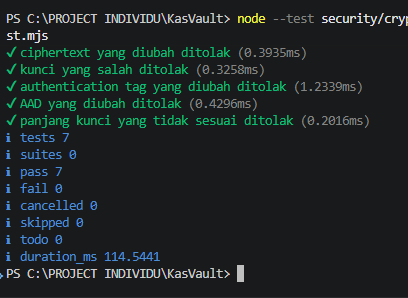
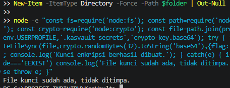
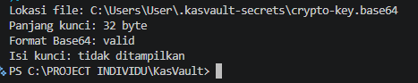

# Hasil Pengujian Kriptografi KasVault

## Lingkungan Pengujian

- Runtime: Node.js
- Modul pengujian: `node:test`
- File implementasi: `security/crypto/crypto.mjs`
- File pengujian: `security/crypto/crypto.test.mjs`
- Algoritma: AES-256-GCM

## Skenario dan Hasil

| No. | Skenario | Hasil |
|---|---|---|
| 1 | Enkripsi dan dekripsi transaksi berhasil | PASS |
| 2 | Teks kosong ditolak | PASS |
| 3 | Ciphertext yang diubah ditolak | PASS |
| 4 | Kunci yang salah ditolak | PASS |
| 5 | Authentication tag yang diubah ditolak | PASS |
| 6 | AAD yang diubah ditolak | PASS |
| 7 | Panjang kunci yang tidak sesuai ditolak | PASS |

## Ringkasan Hasil

- Total pengujian: 7
- Berhasil: 7
- Gagal: 0
- Dibatalkan: 0
- Dilewati: 0

## Cara Menjalankan Pengujian

Jalankan perintah berikut dari direktori utama repository:

```powershell
node --test security/crypto/crypto.test.mjs
```

## Kesimpulan

Berdasarkan hasil pengujian, seluruh tujuh skenario berhasil. Implementasi dapat melakukan enkripsi dan dekripsi dengan kunci yang benar serta menolak ciphertext, authentication tag, AAD, dan kunci yang tidak sesuai.

Hasil ini merupakan bukti pengujian komponen kriptografi, bukan bukti bahwa seluruh data transaksi pada aplikasi sudah menggunakan enkripsi tersebut.
## Bukti Pengujian

### 1. Hasil Pengujian Otomatis



### 2. Pembuatan Kunci Enkripsi



### 3. Verifikasi Kunci Enkripsi


