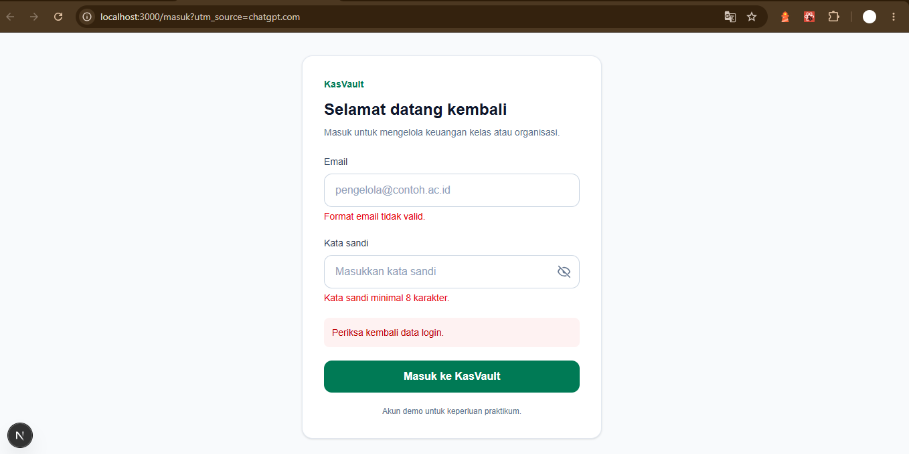
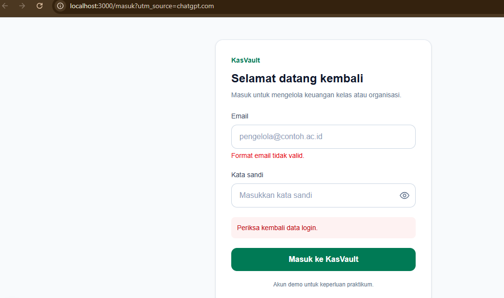
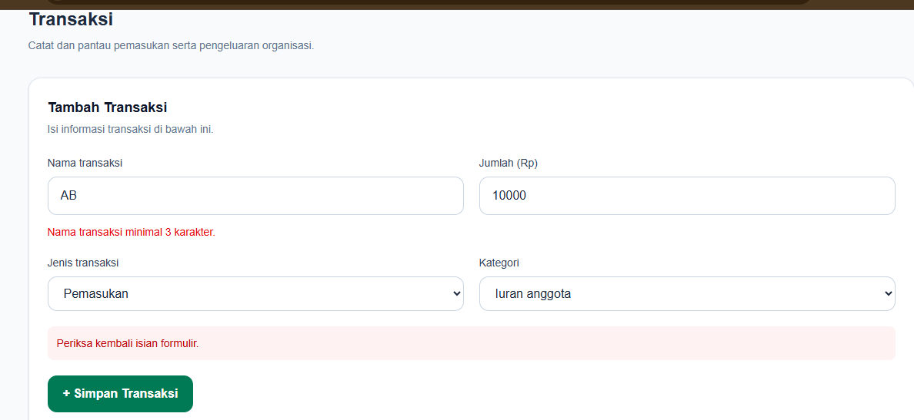

# Dokumen Teknis Modul 5 — Formulir, Validasi, Session, dan Cookie

**Nama:** Wisnu Bimantoro
**NIM:** 105224045
**Repositori:** https://github.com/wsnubmntr/KasVault
**Branch tujuan:** `main`

## 1. Skema Validasi

KasVault menggunakan Zod untuk memvalidasi input pada sisi server. Validasi browser membantu pengguna mengisi formulir, tetapi tidak dapat dijadikan satu-satunya perlindungan karena dapat dilewati.

### 1.1 Tabel kolom formulir

| Formulir | Kolom | Aturan validasi | Pesan galat |
|---|---|---|---|
| Masuk | Email | Harus berformat email yang valid. | Format email tidak valid. |
| Masuk | Kata sandi | Wajib diisi dan minimal 8 karakter. | Kata sandi minimal 8 karakter. |
| Transaksi | Nama transaksi | Spasi awal dan akhir dihapus; panjang 3–100 karakter. | Nama transaksi minimal 3 karakter atau maksimal 100 karakter. |
| Transaksi | Jumlah | Wajib diisi, hanya digit angka, bilangan bulat positif, maksimal Rp100.000.000. | Jumlah transaksi wajib diisi; jumlah harus berupa angka bulat; jumlah harus lebih dari Rp0; atau jumlah maksimal Rp100.000.000. |
| Transaksi | Jenis | Hanya `Pemasukan` atau `Pengeluaran`. | Jenis transaksi tidak valid. |
| Transaksi | Kategori | Hanya `Iuran`, `Sponsor`, `Operasional`, `Kegiatan`, atau `Lainnya`. | Kategori transaksi tidak valid. |

Implementasi skema berada di `src/lib/skema.ts`. Skema transaksi mengubah jumlah dari string menjadi angka setelah pemeriksaan format dan menerapkan batas nilai.

### 1.2 Aturan semantik di Server Action

| Aturan | Alasan |
|---|---|
| Kredensial masuk harus cocok dengan `DEMO_EMAIL` dan `DEMO_KATA_SANDI`. | Format email yang benar tidak menjamin kredensial sesuai. |
| Pengguna harus mempunyai sesi yang valid sebelum menambah transaksi. | Mencegah pengguna tanpa sesi melakukan perubahan data melalui Server Action. |
| Nama transaksi yang sudah digunakan ditolak. | Mencegah duplikasi nama transaksi dalam data simulasi. |
| Data baru hanya ditambahkan setelah pemeriksaan berhasil. | Menghindari perubahan data dari input yang tidak valid. |

Pemeriksaan semantik melengkapi validasi skema. Validasi format saja tidak cukup untuk memutuskan apakah suatu operasi diizinkan.

## 2. Alur Server Action

### 2.1 Alur login

1. Pengguna mengisi email dan kata sandi.
2. Formulir mengirim data ke Server Action.
3. Server memvalidasi input menggunakan skema Zod.
4. Server membandingkan kredensial dengan variabel lingkungan demo.
5. Jika tidak cocok, proses login ditolak dan pesan galat ditampilkan.
6. Jika cocok, aplikasi membuat sesi dan menyimpan ID sesi melalui cookie `sesi`.

### 2.2 Alur logout

1. Pengguna memilih logout.
2. Aplikasi menjalankan proses logout.
3. Sesi pengguna dihapus dan cookie sesi dihapus atau dibuat kedaluwarsa sesuai implementasi.
4. Pengguna kembali ke halaman login.

Penghapusan cookie di browser dan penghapusan sesi di server merupakan dua hal berbeda. Keduanya perlu diperiksa agar sesi lama tidak dapat digunakan kembali.

### 2.3 Alur tambah transaksi

1. Pengguna mengisi nama, jumlah, jenis, dan kategori transaksi.
2. Server Action memeriksa sesi pengguna.
3. Data formulir divalidasi dengan Zod.
4. Pemeriksaan semantik dilakukan, termasuk pemeriksaan nama duplikat.
5. Jika seluruh pemeriksaan berhasil, transaksi ditambahkan ke data aplikasi.
6. Jika input tidak valid, Server Action mengembalikan pesan galat tanpa menambahkan transaksi.

### 2.4 Pembagian berkas

| Berkas | Tanggung jawab |
|---|---|
| `src/lib/skema.ts` | Skema validasi login dan transaksi menggunakan Zod. |
| `src/lib/sesi.ts` | Pengelolaan sesi pada sisi server. |
| `src/proxy.ts` | Pemeriksaan awal keberadaan cookie untuk rute yang dilindungi. |
| `src/app/masuk/actions.ts` | Pemrosesan login melalui Server Action. |
| `src/app/masuk/FormMasuk.tsx` | Formulir login dan tampilan hasil aksi. |
| `src/app/transaksi/actions.ts` | Pemrosesan penambahan transaksi melalui Server Action. |
| `src/app/transaksi/TransaksiForm.tsx` | Formulir transaksi dan tampilan pesan validasi. |
| `lib/data.ts` | Pengelolaan data transaksi simulasi. |

Formulir menggunakan mekanisme Server Action. Pemeriksaan pada sisi server tetap diperlukan walaupun browser telah melakukan validasi.

## 3. Bukti Uji Validasi

### 3.1 Pengujian yang sudah dilakukan

| ID | Skenario | Hasil yang diharapkan | Hasil pengamatan | Status |
|---|---|---|---|---|
| T01 | Login dengan kata sandi salah | Login ditolak. | Pesan `Email atau kata sandi salah.` tampil. | PASS |
| T02 | Login dengan kolom kosong | Input kosong ditolak. | Validasi browser menghentikan pengiriman. | PASS |
| T03 | Login dengan format email tidak valid | Email ditolak. | Validasi browser menghentikan pengiriman. | PASS |
| T04 | Login dengan kredensial demo yang benar | Dashboard dapat dibuka. | Dashboard tampil setelah login. | PASS |
| T05 | Form transaksi kosong | Data tidak valid ditolak. | Pesan kesalahan nama dan jumlah tampil. | PASS |
| T06 | Jumlah transaksi negatif | Jumlah ditolak. | Validasi browser menghentikan pengiriman. | PASS |
| T07 | Nama transaksi `AB` | Nama pendek ditolak. | Pesan nama minimal 3 karakter tampil. | PASS |
| T08 | Jumlah transaksi `0` | Jumlah ditolak. | Validasi browser menghentikan pengiriman. | PASS |
| T09 | Transaksi valid | Transaksi ditambahkan. | Transaksi berhasil dibuat. | PASS |
| T10 | Nama transaksi duplikat | Transaksi kedua ditolak. | Pesan nama transaksi sudah digunakan tampil. | PASS |
| T11 | Logout | Pengguna keluar dari sesi. | Proses logout dilakukan. | PASS |
| T12 | Membuka halaman setelah logout | Pengguna diarahkan ke login. | Halaman login tampil. | PASS |

Status PASS di atas didasarkan pada pengamatan yang telah dicatat. Pengujian tersebut tidak otomatis membuktikan keamanan seluruh mekanisme sesi.

### 3.2 Pengujian dengan validasi browser dilewati

Atribut `noValidate` digunakan pada formulir agar pengujian dapat memastikan validasi server tetap bekerja tanpa mengandalkan validasi bawaan browser.

| ID | Skenario | Hasil yang diharapkan | Hasil pengamatan | Status |
|---|---|---|---|---|
| S01 | Login kosong dengan `noValidate` | Zod menolak email dan kata sandi. | Email menampilkan `Format email tidak valid.`, kata sandi menampilkan `Kata sandi minimal 8 karakter.`, dan pesan umum muncul. | PASS |
| S02 | Email `wisnu-email` dengan `noValidate` | Zod menolak format email. | Pesan format email tidak valid dan pesan umum tampil. | PASS |
| S03 | Nama transaksi `AB`, jumlah `10000`, dengan `noValidate` | Server menolak nama transaksi yang terlalu pendek. | Pesan nama minimal 3 karakter dan pesan umum tampil; transaksi ditolak. | PASS |
| S04 | Jumlah `0` atau negatif dengan `noValidate` | Server menolak jumlah yang tidak positif. | Belum dilakukan pengujian khusus ini. | BELUM DIUJI |

### 3.3 Referensi tangkapan layar

Berkas berikut berada di `docs/praktikum/assets/modul-05/`.

| Bukti | Berkas |
|---|---|
| Login dengan kata sandi salah | `01-login-gagal-kata-sandi.png` |
| Login dengan kolom kosong | `02-login-kolom-kosong.png` |
| Email tidak valid | `03-email-format-tidak-valid.png` |
| Login berhasil | `04-login-berhasil-dashboard.png` |
| Form transaksi kosong | `05-transaksi-form-kosong.png` |
| Jumlah negatif | `06-nominal-negatif.png` |
| Nama transaksi terlalu pendek | `07-nama-transaksi-pendek.png` |
| Jumlah nol | `08-nominal-nol.png` |
| Transaksi valid | `09-transaksi-valid.png` |
| Transaksi duplikat | `10-duplikasi-transaksi.png` |
| Logout | `11-logout-dashboard.png` |
| Halaman login setelah logout | `12-halaman-login-setelah-logout.png` |
| Login kosong dengan `noValidate` | `13-login-kosong-novalidate.png` |
| Email tidak valid dengan `noValidate` | `14-login-email-invalid-novalidate.png` |
| Nama transaksi pendek dengan `noValidate` | `15-nama-transaksi-pendek-novalidate.png` |

Bukti tambahan S01:

Bukti tambahan S02:

Bukti tambahan S03:

## 4. Session dan Cookie

### 4.1 Implementasi sesi

Pengelolaan sesi berada di `src/lib/sesi.ts`. Implementasi menggunakan penyimpanan sesi dalam memori server dan cookie bernama `sesi` untuk membawa ID sesi. Masa berlaku cookie yang diterapkan adalah delapan jam.

| Atribut atau mekanisme | Kegunaan |
|---|---|
| `httpOnly` | Mencegah JavaScript di browser membaca cookie melalui `document.cookie`. |
| `maxAge` | Menentukan masa berlaku cookie, yaitu delapan jam pada implementasi ini. |
| Penyimpanan sesi di server | Memungkinkan server memeriksa apakah ID sesi masih terdaftar. |

Atribut `Secure` dan `SameSite` perlu dikonfirmasi langsung dari konfigurasi cookie sebelum dinyatakan aktif. Cookie `httpOnly` saja tidak membuktikan semua perlindungan cookie sudah diterapkan.

### 4.2 Keterbatasan implementasi

Penyimpanan sesi menggunakan `Map` di memori. Data sesi dapat hilang ketika proses server dimulai ulang dan tidak dibagikan secara otomatis antar-instance aplikasi. Pendekatan ini sesuai untuk simulasi praktikum, tetapi bukan pilihan ideal untuk aplikasi produksi.

### 4.3 Bukti DevTools

Bukti cookie sebaiknya diambil melalui browser DevTools pada tab **Application → Cookies** dan melalui tab **Network** pada respons login yang memuat header `Set-Cookie`.

Saat mengambil tangkapan layar, samarkan nilai cookie, ID sesi, dan informasi rahasia lainnya.

**Status bukti:** Tangkapan layar DevTools dan header `Set-Cookie` belum tersedia dalam catatan pengujian ini. Karena itu, keberadaan dan nilai setiap atribut harus diverifikasi sebelum laporan dikumpulkan.

### 4.4 Pengujian cookie

| ID | Pengujian | Hasil yang diharapkan | Status |
|---|---|---|---|
| C01 | Mengirim cookie sesi palsu | Server menolak sesi yang tidak terdaftar. | BELUM DIUJI |
| C02 | Logout kemudian menggunakan cookie lama | Sesi lama tidak dapat digunakan kembali. | BELUM DIUJI |
| C03 | Memulai ulang server saat sesi masih tersimpan di browser | Sesi dalam memori tidak lagi ditemukan dan pengguna harus login kembali. | BELUM DIUJI |

Pengujian C01 dan C02 penting untuk memastikan server memvalidasi ID sesi, bukan sekadar menerima keberadaan cookie.

## 5. Keputusan Teknis

### 5.1 Mengapa menggunakan sesi di server?

Dengan sesi di server, cookie hanya membawa pengenal sesi, sedangkan status sesi disimpan di server. Server dapat menolak pengenal yang tidak terdaftar atau sesi yang sudah dihapus.

Cookie yang berisi token identitas mandiri mempunyai pertimbangan berbeda, seperti validasi tanda tangan, masa berlaku, dan pencabutan token. Untuk praktikum ini, sesi server lebih mudah dipahami dan digunakan untuk mendemonstrasikan proses login dan logout.

Penyimpanan sesi dalam memori tetap memiliki keterbatasan untuk penggunaan produksi.

### 5.2 Peran `src/proxy.ts` dan pemeriksaan Server Action

`src/proxy.ts` melakukan pemeriksaan awal pada rute yang dilindungi. Pemeriksaan keberadaan cookie membantu mengarahkan pengguna yang belum membawa cookie ke halaman login.

Pemeriksaan tersebut tidak cukup untuk membuktikan bahwa sesi valid. Server Action tetap perlu memanggil pemeriksaan sesi di server sebelum melakukan perubahan data. Pemeriksaan pada lapisan aksi penting karena aksi dapat dipanggil secara langsung tanpa mengandalkan navigasi halaman.

## 6. Kendala dan Penyelesaian

| Kendala | Penyelesaian atau tindak lanjut |
|---|---|
| Validasi browser menghentikan beberapa input sebelum mencapai server. | Menggunakan `noValidate` saat menguji validasi server. |
| Format input yang benar belum tentu memenuhi aturan aplikasi. | Menambahkan pemeriksaan Zod dan aturan semantik di Server Action. |
| Nama transaksi yang sama dapat diajukan lebih dari sekali. | Menambahkan pemeriksaan nama duplikat sebelum menambahkan data. |
| Sesi disimpan dalam memori. | Mencatat keterbatasan bahwa sesi hilang saat proses server dimulai ulang. |
| Bukti cookie belum lengkap. | Menjadwalkan pemeriksaan cookie melalui DevTools dan pengujian sesi palsu serta cookie lama. |

## 7. Catatan Pemanfaatan AI

AI digunakan sebagai alat bantu untuk menyusun dan merapikan dokumentasi, menjelaskan validasi Zod, Server Action, session, cookie, dan membantu merumuskan skenario pengujian.

Bagian yang dibantu meliputi struktur dokumen, penjelasan teknis, tabel pengujian, dan perapian bahasa. Implementasi serta hasil pengujian tetap perlu diperiksa terhadap kode dan perilaku aplikasi yang sebenarnya. Pengujian yang belum dilakukan dicatat sebagai belum diuji, bukan sebagai keberhasilan.

## Referensi

- Next.js — Forms: https://nextjs.org/docs/app/guides/forms
- Zod: https://zod.dev/
- React — `useActionState`: https://react.dev/reference/react/useActionState
- Kode implementasi KasVault: `src/lib/skema.ts`, `src/lib/sesi.ts`, `src/proxy.ts`, `src/app/masuk/`, dan `src/app/transaksi/`.