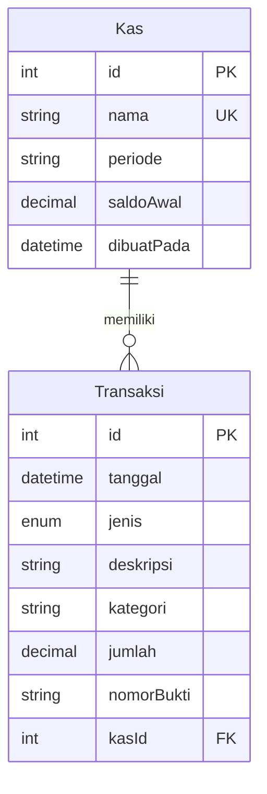

# Dokumen Teknis Modul 6 — PostgreSQL dan Prisma ORM

**Nama:** Wisnu Bimantoro  
**NIM:** 105224045  
**Repositori:** https://github.com/wsnubmntr/KasVault

## 1. Rancangan Data

KasVault menggunakan dua entitas, yaitu `Kas` dan `Transaksi`, dengan relasi one-to-many (1:N). Satu kas dapat memiliki banyak transaksi, sedangkan satu transaksi hanya terhubung ke satu kas melalui atribut `kasId`.

### Diagram relasi



### Kunci dan constraint

| Entitas | Atribut | Keterangan |
|---|---|---|
| Kas | `id` | Primary key, bertambah otomatis |
| Kas | `nama` | Unique, nama kas tidak boleh sama |
| Transaksi | `id` | Primary key, bertambah otomatis |
| Transaksi | `kasId` | Foreign key yang mengacu ke `Kas.id` |
| Transaksi | `kasId`, `nomorBukti` | Unique gabungan agar nomor bukti tidak duplikat dalam kas yang sama |

Relasi menggunakan `onDelete: Restrict`. Aturan ini dipilih agar data kas tidak dapat dihapus ketika masih memiliki transaksi yang terhubung. Dengan begitu, riwayat keuangan tidak ikut terhapus secara tidak sengaja.

## 2. Skema dan Migrasi

### Isi `prisma/schema.prisma`

```prisma
generator client {
  provider = "prisma-client"
  output   = "../generated/prisma"
}

datasource db {
  provider = "postgresql"
}

enum JenisTransaksi {
  PEMASUKAN
  PENGELUARAN
}

model Kas {
  id         Int          @id @default(autoincrement())
  nama       String       @unique
  periode    String
  saldoAwal  Decimal      @db.Decimal(12, 2)
  dibuatPada DateTime     @default(now())
  transaksi  Transaksi[]
}

model Transaksi {
  id         Int            @id @default(autoincrement())
  tanggal    DateTime       @default(now())
  jenis      JenisTransaksi
  deskripsi  String
  kategori   String         @default("Lainnya")
  jumlah     Decimal        @db.Decimal(12, 2)
  nomorBukti String
  kasId      Int
  kas        Kas            @relation(fields: [kasId], references: [id], onDelete: Restrict)

  @@unique([kasId, nomorBukti])
}
```

### Konfigurasi Prisma 7

Proyek menggunakan Prisma ORM 7. Konfigurasi proyek berada di `prisma7.config.ts`:

```ts
import "dotenv/config";
import { defineConfig, env } from "prisma/config";

export default defineConfig({
  schema: "prisma/schema.prisma",
  migrations: {
    path: "prisma/migrations",
    seed: "tsx prisma/seed.ts",
  },
  datasource: {
    url: env("DATABASE_URL"),
  },
});
```

URL koneksi PostgreSQL disimpan dalam variabel `DATABASE_URL` pada file `.env`. File `.env` tidak dimasukkan ke repository karena berisi konfigurasi koneksi lokal.

### Daftar migrasi

Folder migrasi yang telah dibuat dan dimasukkan ke repository:

- `prisma/migrations/20261031094544_init_kasvault/`
- `prisma/migrations/20261031103231_tambah_kategori_transaksi/`

Migrasi pertama membuat tabel `Kas`, tabel `Transaksi`, enum `JenisTransaksi`, primary key, foreign key, serta constraint unik.

Migrasi kedua menambahkan kolom `kategori` pada tabel `Transaksi` dengan nilai default `Lainnya`.

### Pemeriksaan struktur PostgreSQL

Pemeriksaan struktur tabel dilakukan menggunakan perintah berikut:

```powershell
docker exec -it pg-praktikum psql -U praktikum -d produk -c '\d "Kas"'

docker exec -it pg-praktikum psql -U praktikum -d produk -c '\d "Transaksi"'
```

**Bukti pengujian:**

- [Masukkan screenshot hasil pemeriksaan tabel Kas di sini.]
- [Masukkan screenshot hasil pemeriksaan tabel Transaksi di sini.]

Hasil pemeriksaan perlu memperlihatkan kolom tabel, indeks unik, primary key, dan foreign key yang digunakan.

## 3. Seed dan Prisma Client

### Seed

Seed berada pada file `prisma/seed.ts`. Seed digunakan untuk membuat data awal KasVault, yaitu kas bernama `Kas Kelas Ilmu Komputer` dengan periode `2026/2027` dan saldo awal sebesar Rp500.000.

Seed juga membuat transaksi pemasukan awal dengan nomor bukti `TRX-001` dan deskripsi `Saldo awal kas kelas`.

Seed menggunakan metode `upsert`, sehingga data diperiksa berdasarkan kunci unik terlebih dahulu. Jika data sudah tersedia, data tidak dibuat ulang. Jika belum tersedia, data akan dibuat. Dengan demikian, seed dapat dijalankan kembali tanpa menggandakan data yang sama.

Perintah yang digunakan:

```powershell
npx prisma db seed
```

Keluaran yang telah diperoleh:

```text
Seed KasVault berhasil dijalankan!
```

**Bukti pengujian:**

- [Masukkan screenshot keluaran seed pertama.]
- [Masukkan screenshot keluaran seed kedua.]

Untuk membuktikan seed dapat dijalankan ulang, perintah `npx prisma db seed` perlu dijalankan dua kali. Jumlah data sebelum dan sesudahnya juga perlu diperiksa untuk memastikan tidak terjadi duplikasi.

### Prisma Client

Instans Prisma Client dibuat pada file `lib/prisma.ts`. Proyek menggunakan `PrismaPg` dari `@prisma/adapter-pg` sebagai adapter untuk menghubungkan Prisma dengan PostgreSQL.

Penggunaan `server-only` bertujuan agar file koneksi database hanya digunakan pada sisi server dan tidak ikut diimpor ke Client Component.

Seed tidak mengimpor `lib/prisma.ts` karena seed berjalan di luar proses Next.js. Oleh karena itu, seed membuat koneksi Prisma sendiri menggunakan adapter PostgreSQL dan menutup koneksi menggunakan `$disconnect()` setelah proses selesai.

Perintah berikut telah berhasil dijalankan:

```powershell
npx prisma generate
```

Prisma Client berhasil dihasilkan ke folder `generated/prisma`. Data hasil seed juga telah diperiksa melalui Prisma Studio.

## 4. Operasi CRUD

Integrasi database pada KasVault dilakukan dengan mengganti penyimpanan transaksi yang sebelumnya menggunakan array sementara di memori server menjadi penyimpanan PostgreSQL melalui Prisma.

| Entitas | Aksi | Metode Prisma | Keterangan |
|---|---|---|---|
| Kas | Membuat data awal kas | `kas.upsert()` | Digunakan pada seed |
| Transaksi | Membuat transaksi awal | `transaksi.upsert()` | Digunakan pada seed |
| Transaksi | Menambahkan transaksi | `transaksi.create()` | Melalui Server Action |
| Transaksi | Membaca daftar transaksi | Periksa implementasi halaman | Perlu verifikasi |
| Transaksi | Mengubah transaksi | Belum tersedia bukti implementasi | Belum diverifikasi |
| Transaksi | Menghapus transaksi | Belum tersedia bukti implementasi | Belum diverifikasi |

Validasi masukan dilakukan sebelum data disimpan. Server Action juga memeriksa sesi pengguna terlebih dahulu. Jika sesi tidak tersedia, pengguna akan diarahkan ke halaman masuk.

Setelah transaksi berhasil disimpan, halaman transaksi diperbarui menggunakan `revalidatePath` agar data terbaru dapat ditampilkan.

**Bukti pengujian:**

- [Masukkan screenshot formulir tambah transaksi.]
- [Masukkan screenshot transaksi berhasil ditambahkan.]
- [Masukkan screenshot data transaksi pada Prisma Studio.]

Penanganan galat P2002 dan P2025 perlu diperiksa kembali pada implementasi aplikasi. Kedua galat tersebut belum dinyatakan berhasil ditangani apabila belum ada bukti pengujian langsung.

## 5. Transaksi dan Rollback

Relasi antara `Kas` dan `Transaksi` menggunakan aturan `onDelete: Restrict`. Artinya, PostgreSQL menolak penghapusan data kas apabila masih terdapat transaksi yang terhubung dengan kas tersebut.

Aturan ini digunakan untuk menjaga riwayat keuangan agar tidak terhapus secara tidak sengaja.

Pada implementasi yang telah dikonfirmasi, aturan `Restrict` sudah tercantum pada schema Prisma. Namun, pengujian penghapusan kas yang masih memiliki transaksi dan pembuktian rollback menggunakan `$transaction` masih perlu dilakukan.

Pengujian yang perlu dilakukan:

1. Mencoba menghapus kas yang masih memiliki transaksi dan mencatat hasil penolakan dari foreign key.
2. Menjalankan beberapa operasi yang saling berhubungan menggunakan `prisma.$transaction(...)`.
3. Membuat salah satu operasi gagal secara sengaja pada data uji.
4. Memeriksa data sebelum dan sesudah pengujian untuk memastikan perubahan dibatalkan seluruhnya.

**Hasil aktual:** Pengujian rollback belum diverifikasi dan bukti pengujian belum tersedia.

**Bukti pengujian:**

- [Masukkan screenshot galat RESTRICT.]
- [Masukkan screenshot data sebelum pengujian rollback.]
- [Masukkan screenshot data sesudah pengujian rollback.]

## 6. Skenario Uji

Skenario pengujian disesuaikan dengan fitur KasVault yang menggunakan PostgreSQL dan Prisma ORM.

| No. | Skenario | Hasil yang diharapkan | Hasil aktual | Status |
|---|---|---|---|---|
| 1 | Koneksi aplikasi ke PostgreSQL | Aplikasi berhasil terhubung ke database | Koneksi PostgreSQL berhasil diverifikasi | Lulus |
| 2 | Menjalankan migrasi schema | Tabel dan relasi terbentuk di PostgreSQL | Migrasi berhasil diterapkan | Lulus |
| 3 | Menjalankan seed pertama kali | Data kas dan transaksi awal berhasil dibuat | Seed berhasil dijalankan | Lulus |
| 4 | Menjalankan seed untuk kedua kalinya | Tidak membuat data duplikat | Perlu diuji kembali dan dibandingkan jumlah datanya | Belum diuji |
| 5 | Menambahkan transaksi valid | Transaksi berhasil tersimpan di database | Penambahan transaksi dilaporkan berhasil | Lulus* |
| 6 | Memuat ulang halaman transaksi | Data tetap tampil setelah halaman di-refresh | Persistensi setelah refresh dilaporkan berhasil | Lulus* |
| 7 | Memeriksa data melalui Prisma Studio | Data kas dan transaksi dapat dilihat | Data berhasil diverifikasi melalui Prisma Studio | Lulus |
| 8 | Memakai nomor bukti yang sama dalam kas yang sama | Database menolak data duplikat | Belum ada hasil pengujian terkonfirmasi | Belum diuji |
| 9 | Menghapus kas yang masih memiliki transaksi | Penghapusan ditolak oleh aturan RESTRICT | Belum ada hasil pengujian terkonfirmasi | Belum diuji |
| 10 | Menguji rollback ketika operasi transaksi gagal | Semua perubahan dalam transaksi dibatalkan | Belum ada bukti pengujian rollback | Belum diuji |

Keterangan: tanda * menunjukkan hasil yang dilaporkan selama pengerjaan dan checklist Pull Request. Screenshot aplikasi dan database perlu dilampirkan sebagai bukti pendukung.

**Rekap sementara:** Sebanyak 6 dari 10 skenario telah dilaporkan berhasil, sedangkan 4 skenario belum diuji. Persentase sementara adalah 60%. Hasil tersebut belum memenuhi ambang kelulusan modul, yaitu minimal 9 dari 10 skenario atau 90%. Pengujian yang belum dilakukan perlu diselesaikan sebelum dokumen dikumpulkan.

## 7. Kendala dan Penyelesaian

| Kendala | Penyebab | Penyelesaian |
|---|---|---|
| Penambahan kolom `kategori` gagal saat migrasi | Kolom baru wajib diisi, sedangkan tabel sudah memiliki data sebelumnya | Menambahkan nilai default `Lainnya` agar data lama memiliki nilai pada kolom tersebut |
| Prisma Client perlu mengikuti schema terbaru | Tipe Prisma Client perlu diperbarui setelah perubahan schema | Menjalankan `npx prisma generate` |
| Penyimpanan transaksi sebelumnya masih menggunakan array di memori | Data simulasi tidak tersimpan secara permanen | Mengintegrasikan Prisma dan PostgreSQL pada proses penambahan transaksi |
| Memastikan data tersimpan secara permanen | Data perlu diperiksa setelah halaman dimuat ulang | Melakukan refresh halaman dan memeriksa data melalui Prisma Studio |

## 8. Catatan Pemanfaatan AI

AI digunakan sebagai alat bantu selama proses praktikum, terutama untuk membantu memahami konfigurasi Prisma ORM 7, menelusuri penyebab kesalahan migrasi, dan menyusun penjelasan teknis dalam dokumentasi.

Bagian yang dibantu meliputi:

- Memahami konfigurasi Prisma 7 dan koneksi PostgreSQL.
- Menelusuri penyebab kegagalan migrasi ketika menambahkan kolom wajib pada tabel yang sudah memiliki data.
- Membantu memahami struktur relasi, constraint, dan konfigurasi Prisma Client.
- Membantu menyusun kerangka dokumentasi dan tabel skenario pengujian.

Hasil bantuan AI tidak langsung dianggap benar. Perintah dan perubahan kode diperiksa kembali melalui Prisma CLI, PostgreSQL, Prisma Studio, pemeriksaan TypeScript, serta pengujian aplikasi. Pelaksanaan perintah dan keputusan akhir tetap dilakukan oleh mahasiswa.