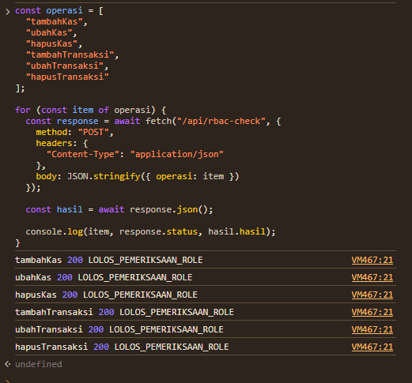
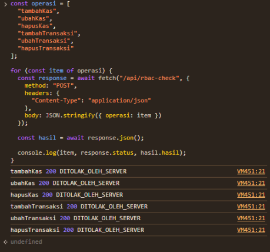

# Access Control Implementation & Testing — KasVault

## 1. Tujuan

Dokumen ini menjelaskan implementasi kontrol akses berbasis peran (*Role-Based Access Control/RBAC*) pada KasVault. Tujuannya adalah membatasi fungsi pengelolaan keuangan agar hanya dapat dijalankan oleh pengguna yang memiliki kewenangan.

KasVault menggunakan dua peran pengguna, yaitu Bendahara dan Anggota. Bendahara memiliki kewenangan mengelola data kas dan transaksi, sedangkan Anggota hanya dapat melihat informasi keuangan.

## 2. Matriks Hak Akses

| Fitur | Bendahara | Anggota |
|---|---|---|
| Melihat Dashboard | Diizinkan | Diizinkan |
| Melihat Data Kas | Diizinkan | Diizinkan |
| Menambah Kas | Diizinkan | Ditolak |
| Mengubah Kas | Diizinkan | Ditolak |
| Menghapus Kas | Diizinkan | Ditolak |
| Melihat Transaksi | Diizinkan | Diizinkan |
| Menambah Transaksi | Diizinkan | Ditolak |
| Mengubah Transaksi | Diizinkan | Ditolak |
| Menghapus Transaksi | Diizinkan | Ditolak |
| Melihat Tujuan Keuangan | Diizinkan | Diizinkan |
| Menambah Tujuan Keuangan | Diizinkan | Ditolak |

## 3. Implementasi Kontrol Akses

### 3.1 Autentikasi

KasVault menggunakan autentikasi berbasis email dan kata sandi. Penyimpanan kata sandi menggunakan algoritma bcrypt dengan cost factor 12.

Kredensial akun demo disimpan melalui environment variable, sedangkan informasi kata sandi asli disimpan di luar repository.

### 3.2 Pengelolaan Sesi

Sesi pengguna dibuat menggunakan UUID acak dan disimpan di server. Cookie sesi menggunakan konfigurasi:

- HttpOnly: aktif.
- SameSite: Lax.
- Secure: aktif pada environment production.
- Masa berlaku: 8 jam.

Catatan: penyimpanan sesi saat ini menggunakan Map di memori server. Sesi akan hilang ketika server dimulai ulang. Mekanisme ini masih ditujukan untuk demonstrasi lokal dan belum sesuai untuk deployment multi-instance.

### 3.3 Pemeriksaan Hak Akses

Pemeriksaan hak akses ditempatkan pada fungsi `src/lib/akses.ts`.

Fungsi `wajibLogin()` memastikan pengguna sudah memiliki sesi aktif. Fungsi `wajibRole()` memeriksa apakah peran pengguna sesuai dengan peran yang dibutuhkan.

Pemeriksaan tersebut diterapkan pada enam Server Actions:

1. `tambahKasAction`
2. `ubahKasAction`
3. `hapusKasAction`
4. `tambahTransaksiAction`
5. `ubahTransaksiAction`
6. `hapusTransaksiAction`

Seluruh operasi tersebut memanggil `await wajibRole("BENDAHARA")` sebelum menjalankan validasi dan operasi database.

## 4. Pengujian Kontrol Akses

Pengujian dilakukan menggunakan akun demo Bendahara dan Anggota melalui endpoint pengujian sementara yang memanggil Server Actions asli.

Pengujian menggunakan input ID tidak valid untuk operasi ubah dan hapus, serta input kosong untuk operasi tambah. Dengan demikian, pengujian tidak dimaksudkan untuk mengubah data database.

### 4.1 Pengujian Positif

Pengujian positif memastikan akun Bendahara dapat melewati pemeriksaan peran.

| No. | Operasi | Hasil yang Diharapkan | Hasil Aktual |
|---|---|---|---|
| 1 | Tambah Kas | Lolos pemeriksaan role | Berhasil |
| 2 | Ubah Kas | Lolos pemeriksaan role | Berhasil |
| 3 | Hapus Kas | Lolos pemeriksaan role | Berhasil |
| 4 | Tambah Transaksi | Lolos pemeriksaan role | Berhasil |
| 5 | Ubah Transaksi | Lolos pemeriksaan role | Berhasil |
| 6 | Hapus Transaksi | Lolos pemeriksaan role | Berhasil |

### 4.2 Pengujian Negatif

Pengujian negatif memastikan akun Anggota tidak dapat melewati pemeriksaan peran Bendahara.

| No. | Operasi | Hasil yang Diharapkan | Hasil Aktual |
|---|---|---|---|
| 1 | Tambah Kas | Ditolak server | Ditolak |
| 2 | Ubah Kas | Ditolak server | Ditolak |
| 3 | Hapus Kas | Ditolak server | Ditolak |
| 4 | Tambah Transaksi | Ditolak server | Ditolak |
| 5 | Ubah Transaksi | Ditolak server | Ditolak |
| 6 | Hapus Transaksi | Ditolak server | Ditolak |

### 4.3 Rekapitulasi Pengujian

| Jenis Pengujian | Jumlah | Berhasil |
|---|---:|---:|
| Positif — Bendahara | 6 | 6 |
| Negatif — Anggota | 6 | 6 |
| **Total** | **12** | **12** |

Seluruh 12 pengujian langsung terhadap pemeriksaan role berhasil. Enam pengujian positif menunjukkan bahwa Bendahara melewati pemeriksaan role, sedangkan enam pengujian negatif menunjukkan bahwa Anggota ditolak oleh server.

Hasil ini membuktikan pemeriksaan otorisasi berjalan pada keenam Server Actions. Hasil positif bukan pengujian keberhasilan perubahan data CRUD karena input yang digunakan sengaja tidak valid.

Pengujian simulasi tambahan menggunakan Node.js Test Runner juga menghasilkan 13 pengujian berhasil dan 0 gagal. Pengujian simulasi tersebut dicatat terpisah dari pengujian langsung Server Actions.

## 5. Hubungan dengan Risk Assessment

Implementasi dan pengujian RBAC mendukung penanganan risiko berikut:

| ID Risiko | Ancaman | Kontrol yang Diterapkan | Bukti |
|---|---|---|---|
| E-01 | Anggota memperoleh hak Bendahara | Pemeriksaan role pada enam Server Actions | 6 pengujian negatif |
| E-02 | Akses langsung ke fungsi administratif | Otorisasi di sisi server | Pengujian langsung melalui endpoint sementara |
| T-01 | Perubahan nominal transaksi tanpa izin | Pemeriksaan role sebelum validasi dan operasi transaksi | Pengujian tambah, ubah, dan hapus transaksi |

## 6. Batasan Implementasi

Beberapa batasan yang masih perlu diperhatikan:

1. Penyimpanan sesi masih menggunakan Map di memori.
2. Pembatasan percobaan login belum dibuktikan melalui pengujian.
3. Audit log aktivitas belum diimplementasikan.
4. Pengujian positif membuktikan lolosnya pemeriksaan role, bukan keberhasilan operasi CRUD.
5. Fitur Tujuan Keuangan masih menggunakan state lokal pada komponen, bukan penyimpanan database yang dilindungi oleh Server Actions.

## 7. Kesimpulan

KasVault telah menerapkan kontrol akses berbasis peran untuk membedakan kewenangan Bendahara dan Anggota.

Hasil pengujian langsung menunjukkan enam operasi sensitif berhasil melewati pemeriksaan role untuk Bendahara dan seluruh enam operasi ditolak ketika dijalankan menggunakan akun Anggota.

Dengan demikian, implementasi ini mendukung mitigasi risiko E-01, E-02, dan T-01. Meskipun demikian, keamanan secara keseluruhan masih memerlukan pengembangan lanjutan, khususnya pada penyimpanan sesi, audit log, dan pengujian operasi CRUD.